# Images and browser device control

The E1004 displays 1200 × 1600 pixels using black, white, yellow, red, blue, and green.
The [E1004 manual](https://wiki.seeedstudio.com/getting_started_with_reterminal_e1004/) identifies the panel, 8 MB of external working memory, and 32 MB of flash.
The [panel driver](https://github.com/Seeed-Projects/OSHW-reTerminal-Series-E-D/blob/main/examples/base/GxEPD2_reTerminal_E1004/GxEPD2_T133A01_1200x1600.h) disables partial and fast partial refresh.
The firmware uses full refresh and records a newly presented image only after a successful update.

## Prepare an image

Run the browser app locally.

```sh
mise x -- just web
```

Open the address printed by the command.
Images opens with a file chooser and a preview.
Daily contains the checklist, note, and calendar preview.
Device contains the connection and saved-image actions.
The tabs support arrow keys, Home, End, and normal Tab navigation under the [W3C tabs pattern](https://www.w3.org/WAI/ARIA/apg/patterns/tabs/).
Switching workspaces preserves drafts.

Choose an image from 1 to 8 and select a file.
The file chooser accepts `PNG`, `JPEG`, `WebP`, `BMP`, `GIF`, and prepared image files.
`GIF` import uses the first frame.
General images must fit within 20 MiB, 16384 pixels per side, and 16777216 pixels.
Decoded source pixels share a 128 MiB library limit.
The converter composites transparent pixels onto white.
Conversion runs locally in the browser without uploading the source file to a service.

Choose Fit inside, Fill and crop, Original size, or Stretch, then choose one of nine image positions.
Orientation determines the logical image dimensions before conversion.
Choose six colors or black and white.
Balanced uses ordered Bayer dithering, Photo detail uses Floyd–Steinberg error diffusion, and Solid colors disables dithering.
Brightness, contrast, saturation, and inversion affect the source before palette selection.
Valid edits update the preview automatically after a short pause.
Each image retains its original source and editing values.
Invalid input preserves the preceding valid preview and blocks saving or sending until corrected.
Reset edits restores the default editing values.
Remove image offers Undo removal until another image replaces the removed entry.
Image placement and quantization follow the operations described in the [Seeed image cookbook](https://wiki.seeedstudio.com/reterminal_e10xx_with_arduino_peripherals/).
The cookbook offers alternative algorithms.
The app provides the three named dithering choices.

Create text image renders Unicode with the browser's local fonts.
Reduce text size or shorten content when the text doesn't fit.
Create QR code uses the [Nayuki generator](https://www.nayuki.io/page/qr-code-generator-library), medium error correction or stronger when capacity permits, and a white quiet zone.
The development tools provide Create palette image for inspecting the six supported colors.
Screen colors approximate the physical pigments.
Inspect the palette on the delivered panel when judging color.

## Save and reuse prepared images

Save image downloads a `PNG` containing the visible 1200 × 1600 pixel preview.
Save for SD card, under Slideshow and image library, exports `IMAGE1.EPD` through `IMAGE8.EPD` according to the selected image.
Each file contains a 32-byte versioned header and 960000 packed pixel bytes.
Header and pixel checksums, exact length, orientation, and every palette nibble are validated on import.
The app also accepts the `.e1004-image` extension.
Import prepared files into another local image entry to reuse and edit an image.
Save images before closing the browser to keep a copy.

The native preview opens the same prepared file and can export a `PNG`.

```sh
mise x -- just sim --image IMAGE1.EPD --png target/image.png
```

## Control a device

Connect a data cable and wake the device with a button.
Choose Send to display from Images or Daily, then select the E1004 in the browser's connection window.
Connect display in Device provides a separate connection action.
[Web Serial](https://developer.chrome.com/docs/capabilities/serial) requires browser support and a secure context, including localhost.
Chrome and Edge provide the intended desktop connection path.
The connection uses 115200 baud and a bounded awake lease.

Send to display in Images transfers a snapshot of the selected image to the same device image number.
The snapshot includes the visible orientation and slideshow setting.
Editing another image during transfer doesn't change the outgoing snapshot.
Each acknowledged chunk includes an operation identifier and an exact byte offset.
The device checks stored bytes before acknowledging progress and validates the entire staged image before committing it.
Cancel sending aborts after the current acknowledged chunk.
An inactive transfer expires after 60 seconds without a device command for that transfer.
An interrupted replacement leaves the previous committed slot available.

Image sent means the device saved the image and requested a display update.
Check display requests the device state.
The development output includes the requested state and the last successfully shown image generation.
Device output also reports `display_complete` or `display_failed` after the panel operation.
A full refresh takes tens of seconds according to the [Seeed display guide](https://wiki.seeedstudio.com/reterminal_e10xx_with_arduino/).
Actual latency remains a physical measurement.

Show saved image selects an existing device image without uploading pixels.
Send to display in Daily validates the task and note drafts before applying and sending the content.
The device saves changed preferences before sleeping.
Check display, Refresh display, Sleep display, and Disconnect provide direct actions.
Wireless radios remain off in the default firmware.
The browser connection uses USB.
A network association alone doesn't provide a browser server.

## Development tools

Add `?tools` to the local app address to reveal Tools.
The optional workspace contains simulated measurements, display completion, faults, recording, and device commands.
Device command provides the complete console surface.
Enter `help` for accepted commands.
Event recordings contain commands without image payloads.
Save images before resetting or replaying the preview.

## Import from a card

Copy `IMAGE1.EPD` through `IMAGE8.EPD` to the root of a FAT32 card, using the slot number in the filename.
Insert the card and choose Import from SD for the selected slot, or enter image import N through the console.
The device reads and validates the prepared file before replacing the internal image.
Missing files, removal, invalid palette values, truncation, and checksum failures reject the import.
The panel and card share one bus owner, and long file reads yield between bounded chunks.
After a successful import, the image remains available from internal flash without the card.

## Use the gallery offline

Gallery holds eight committed images.
Short side presses select the previous or next populated slot and skip empty slots.
Hold a side button to leave Gallery.
The middle button starts or pauses the slideshow, and holding the middle button measures and retries a display update.
Slideshow intervals range from 60 to 86400 seconds, and selection survives deep sleep.
Automatic selection uses a checksummed retained snapshot without rewriting settings flash on every slide.
Power loss restores the last manual selection.
While a slideshow is running, timer wake advances once and coalesces missed awake intervals.
A paused image sleeps until button input instead of scheduling periodic redraws.
Empty Gallery retains the normal timed refresh behavior.

## Storage and presentation

Nine 1 MiB flash slots hold eight current image records and one staging or obsolete record.
The image partition starts after the existing factory partition, leaving settings addresses unchanged.
Programming changes erased bits without erasing them again, then writes a commit marker last.
The general flash write method erases sectors during each write and is unsuitable for image chunks.
The [storage decision](../adr/store-packed-color-media-in-transactional-flash-slots.md) records the design.

```mermaid
%%{init: {'theme': 'base', 'themeVariables': {'primaryColor': '#ffffff', 'primaryTextColor': '#000000', 'primaryBorderColor': '#000000', 'lineColor': '#000000', 'secondaryColor': '#ffffff', 'tertiaryColor': '#ffffff'}}}%%
flowchart LR
    A[Browser conversion] --> B[Prepared image]
    B --> C[USB chunks or card import]
    C --> D[Staging flash slot]
    D --> E[Readback and checksum]
    E --> F[Commit marker]
    F --> G[Gallery selection]
    G --> H[Full panel update]
    H --> I[Successful presentation]
```



Host tests exercise the production task graph, interrupted transfers, card input, restart, and presentation authority.
Browser tests exercise file preparation, six-color and monochrome pixels, text and QR images, complete serial transfer, cancellation, rejection, and stream cleanup through a modeled port.
Compiler results and modeled ports don't establish physical color quality, electrical timing, battery life, or a physical USB connection.
Device flashing remains an owner action.
